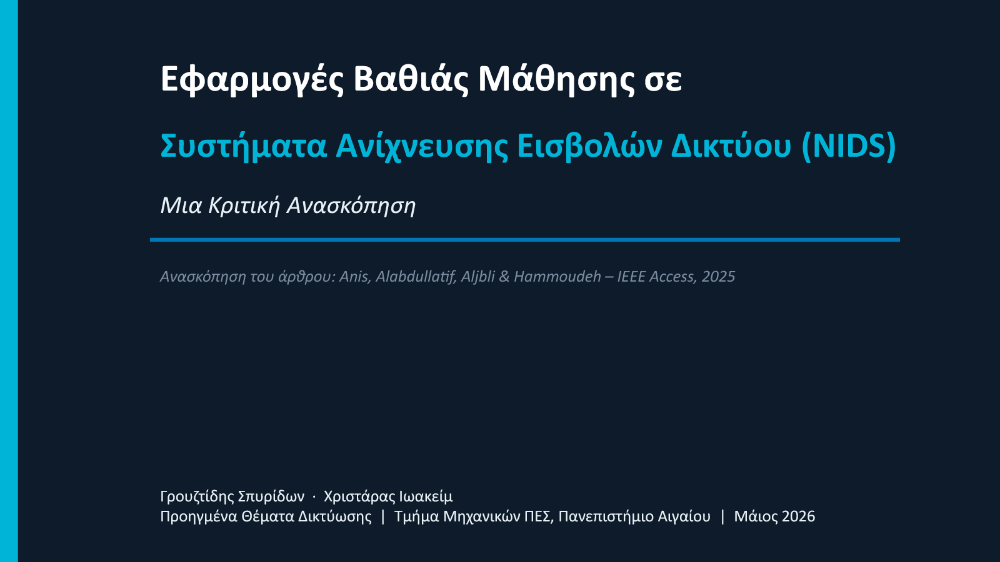

# Deep Learning for Network Intrusion Detection: A Critical Review

This repository presents a critical review of deep-learning approaches to network intrusion detection systems (NIDS). It examines autoencoders and generative models, Transformers, CNN/DNN architectures, hybrid systems, and federated learning, with emphasis on dataset quality, generalization, adversarial robustness, privacy, latency, explainability, and operational deployment.

The project was prepared for the University of the Aegean course **Advanced Networking Topics** during the 2025–2026 academic year.

## Repository contents

- [Critical review report](source/deep-learning-nids-critical-review-report.pdf) — the complete report in PDF format.
- [Editable report](source/deep-learning-nids-critical-review-report.docx) — the Word source with public metadata and student identifiers removed.
- [Presentation](source/deep-learning-nids-critical-review-slides.pdf) — the presentation in PDF format.
- [Editable presentation](source/deep-learning-nids-critical-review-slides.pptx) — the PowerPoint source with corrected claims, speaker-note citations, and a portable native dataset chart.
- [Representative evidence matrix](analysis/representative-evidence-matrix.csv) — structured extraction of selected systems and findings discussed in the report.
- [Methodology and limitations](analysis/methodology-and-limitations.md) — scope, evidence boundaries, and interpretation notes.
- [References](references/references.md) — the bibliography with persistent links where available.

## Main findings

1. Reported within-dataset scores are often high, but cross-dataset performance can fall substantially.
2. CIC-IDS2017, UNSW-NB15, and NSL-KDD dominate the evaluated corpus, which limits confidence in real-world generalization.
3. Lightweight CNNs are promising for edge filtering, while Transformer models can support deeper server-side analysis. The two-tier SOC design in the presentation is a conceptual deployment interpretation, not an implemented benchmark.
4. Federated learning can reduce centralized raw-traffic collection, but it does not by itself guarantee privacy, security, GDPR compliance, or HIPAA compliance.
5. Adversarial evaluation exists in isolated studies, yet the surveyed corpus lacks a unified robustness benchmark and a systematic comparison of defenses.

## Method

This is a critical review centered on the 2025 IEEE Access survey by Anis et al. and supported by related surveys and foundational sources. The work synthesizes the survey's taxonomy, reported measurements, and dataset usage, then evaluates the operational limits of those findings.

It is **not** an independent PRISMA systematic review, a reproduction of all 31 primary studies, or an implementation of a production NIDS. Numerical results in the evidence matrix are survey-reported unless explicitly stated otherwise.

## Original contribution

The portfolio value of this project lies in the critical layer added to the source survey: separating benchmark performance from operational evidence, identifying unsupported compliance and robustness claims, mapping model families to deployment constraints, and documenting the evidence boundaries transparently.

## Source survey

F. M. Anis, M. Alabdullatif, S. Aljbli, and M. Hammoudeh, “A Survey on the Applications of Deep Learning in Network Intrusion Detection Systems to Enhance Network Security,” *IEEE Access*, 2025. [https://doi.org/10.1109/ACCESS.2025.3624952](https://doi.org/10.1109/ACCESS.2025.3624952)

The third-party article PDF is not redistributed in this repository. Use the DOI above to access the publisher record and the license attached to the article.

## Authors

- Spyridon Grouztidis
- Ioakeim Christaras

## License and reuse

The project authors retain all rights to the original report, slides, and analysis in this repository. See [LICENSE.md](LICENSE.md). Referenced third-party works remain subject to their own licenses.
